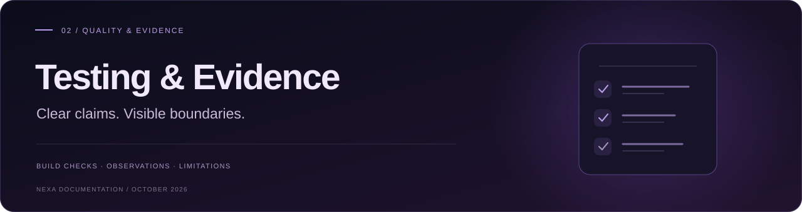

<a id="top"></a>

<p align="center">
  
</p>

<div align="center">

# Testing & evidence

What passed, what was observed, and what remains to be checked.

[](https://github.com/yasmeenmh90-beep/nexa-public/blob/main/tests/chat.test.mjs) [](#private-release) [](#evidence-standard) [](#remaining-checks)

[Overview](README.md) &nbsp; / &nbsp; [Workflow atlas](NEXA_WORKFLOWS.md) &nbsp; / &nbsp; **Testing report** &nbsp; / &nbsp; [Roadmap](NEXT_CASE_STUDY_PLAN.md)

<sub>RELEASE SNAPSHOT · 26 OCTOBER 2026 · YASMEEN AZMAT ALI</sub>

</div>

---

<a id="evidence-standard"></a>

> [!IMPORTANT]
> **Evidence standard:** source/build checks, mocked backend tests, owner reports and visible recordings are different kinds of evidence. This report is not a security audit or accessibility certification.

| Engineering checks | User-supplied evidence | Review still open |
| :--- | :--- | :--- |
| TypeScript + production bundle | General chat, voice and visitor tools | Real-device and accessibility coverage |
| **10 mocked backend tests** | Tour navigation and interview feedback | Full interview progression and tour focus behavior |
| Static render + motion lifecycle | Sample-interface history | Current Lighthouse and operating controls |

**On this page**  
[Private desktop release](#private-release) · [Public release](#current-release) · [Data flow](#network-behavior) · [Historical baseline](#historical-baseline) · [Remaining checks](#remaining-checks) · [Related evidence](#related-evidence)

---

<a id="private-release"></a>

## 00 · Private desktop release: 25 October 2026

The private desktop app and its n8n workflows are not public. Results below come from the build environment (automated) and from the owner running the app on her Mac (end to end). Personal email and calendar content is deliberately not reproduced here.

### Automated checks (desktop app)

| Check | Result |
| --- | --- |
| TypeScript compilation | Passed |
| Vite production build | Passed |
| Automated tests (`node --test`) | **26 passed, 0 failed** |
| Fresh install from the release ZIP | Tests passed again after `npm ci` |

<details>
<summary><strong>What the 26 tests cover</strong></summary>

- **n8n connection (5):** only HTTPS n8n Cloud production URLs; no embedded credentials or query strings; Basic Auth header; session rotation on Reset and reuse for confirmations; 1–2000 character messages; malformed replies and authentication errors handled without leaking upstream text.
- **Action previews (3):** detects each Action Intelligence preview and its exact approval phrase; ignores ordinary replies and unexpected phrases; 15-minute expiry.
- **Alerts (7):** feed URL validation; item validation and trimming; Basic Auth GET; each alert notifies once, including after a restart; at most five notifications per check plus a summary; failed checks reported safely; no checks between 23:00 and 07:00.
- **Existing desktop tests (11):** desktop setup (2), window lifecycle (4), local Ollama requests (4) and bounded microphone audio (1).

</details>

### Owner end-to-end tests (25 October, through the desktop app)

| # | Test | Observed result |
| --- | --- | --- |
| 1 | Tomorrow's calendar | Three calendars read; empty day reported correctly with a free window |
| 2 | Unread important email | Two real unread messages summarised with reasons |
| 3 | Projects needing attention | Ranked list grounded in the tracker, with last-updated dates |
| 4 | Recent GitHub activity | Newest commits across repositories, with UTC times |
| 5 | Projects for an AI/ML internship | Evidence-tagged answer citing CV, portfolio, READMEs and tracker |
| 6 | Portfolio links | 40 links checked; two demos reported as temporarily unavailable (HTTP 503), none broken |
| 7 | Plan tomorrow | Time-blocked plan from calendar, Gmail and tracker; nothing added to the calendar |
| 8 | Free-form availability question | Correct afternoon window (previously rejected by the app) |
| 9 | Send email to self | Preview → Approve → "Gmail confirmed it as sent"; message received |
| 10 | Create, then delete, a calendar event | Preview → confirm → Google Calendar confirmed creation; deletion targeted the same event ID and was confirmed |

**Found during testing:** asking to plan *tomorrow* produced a heading that said "TODAY" with tomorrow's date (cosmetic, in the Daily specialist's wording).

### Not yet verified

- A real proactive alert arriving as a macOS notification (schedule and feed were published 25 October, during quiet hours).
- Cancel and 15-minute expiry in real use (covered by automated tests and the workflow design, not yet observed end to end).
- Two near-simultaneous confirmations of the same action (protected by a claim token plus a 3-second re-check; reduces the risk but does not make it provably impossible).

<a id="current-release"></a>

> **Reviewed application source:** [`0ea3dab`](https://github.com/yasmeenmh90-beep/nexa-public/commit/0ea3dab6cf02051e6d8ee9989542b55d0b5792e7). This documentation styling update does not rerun those engineering checks.

## 01 · Public website release: 15 October 2026

### Automated and static checks

| Check | Recorded result | What it establishes |
| --- | --- | --- |
| TypeScript compilation | Passed | Source/component type consistency |
| Vite production bundle | Passed | Public frontend bundles successfully |
| Backend tests | **10 passed** | Request handling and configured API payload behavior with OpenAI mocked |
| Static React render | Passed | Unique IDs, valid local anchors/assets, existing tour destinations and dialog labels |
| Motion lifecycle checks | Passed for the motion release | Reveal setup, reduced-motion/unsupported-observer fallback and listener cleanup |
| Deployment assets | Updated feature bundles detected on the public host | New client code reached the host; not a full browser interaction test |

Reproduce application checks from the source repository, not from this documentation-only repository:

```bash
npm ci
npm run typecheck
npm run build
node --test tests/chat.test.mjs
```

<details>
<summary><strong>Explore what the 10 backend tests cover</strong></summary>

The test suite covers:

1. Forwarding bounded follow-up context while dropping extra history-item fields.
2. A first question without history.
3. Rejecting privileged roles, invalid order and oversized/malformed history.
4. Accepting the maximum permitted history.
5. Rejecting invalid messages and oversized payloads without an upstream call.
6. Disabled-chat and foreign-origin handling.
7. Generic upstream-throttling errors without leaking upstream error content.
8. Fixed interview track/level instructions and educational coaching boundaries.
9. Rejecting unsupported purposes and interview settings.
10. Keeping general chat separate from interview instructions.


</details>

Tests do **not** call a live model, validate coaching quality, prove Netlify’s deployed throttling behavior, or certify production security.

### Browser and owner-supplied observations

| Feature | Evidence available | Status / limit |
| --- | --- | --- |
| General Live AI answers | Owner reports successful written answers | User-confirmed |
| Follow-up context, copying and suggestions | Owner confirmed the requested visitor-tool tests worked | User-confirmed; no isolated per-control automated browser log |
| Speech recognition | Owner confirmed dictated text appeared after the recognition fix | User-confirmed; browser/provider dependent |
| Spoken replies | Owner reports audible replies; later screenshot displays Speaking / Voice playing | User-confirmed audio; screenshot proves UI state, not sound quality |
| Speaking halo and bars | Screenshots/recordings show playback visuals | Visually observed; no mouth synchronization |
| Guided tour | Recording shows opening and navigation between sections | Visually observed; full Back/Escape/focus/phone coverage still pending |
| Interview start | Recording shows the supervised-versus-unsupervised-learning question | Visually observed |
| Interview feedback | Screenshot shows a submitted answer, a Strength response and the start of an Improvement section | Visually observed |
| Next interview question after feedback | Not visible in the supplied final feedback screenshot | Still needs explicit verification |
| Current desktop presentation | Supplied scrolling recordings | No obvious overlap in sampled views; not frame-by-frame performance measurement |
| Current mobile/tablet and accessibility | Not comprehensively evidenced after the latest redesign | Pending device and assistive-technology review |

The October 15 recordings/screenshots were supplied in the project conversation. They are not embedded or publicly hosted by this documentation update. Do not infer unobserved outcomes from a screenshot of a control.

<a id="network-behavior"></a>

## 02 · Current network and data behavior

- **Sample Demo** selects fictional local replies and does not call OpenAI.
- **Live AI** sends a submitted message, bounded recent user/assistant history and selected experience settings to `/api/chat`. The server calls OpenAI.
- History is limited to six alternating messages, up to 2000 characters each and 6000 characters total.
- Reset, mode changes and refresh clear this app’s browser-held context. Interview track/level changes also start a new session.
- Browser voice recognition may use the browser provider’s speech service.
- Public chat does not connect to n8n, personal email/calendar services, private repositories or long-term memory.
- Feedback links open public GitHub issue drafts. They do not automatically submit an issue or attach conversation text.

The function source configures a 48,000-byte body limit, 1–1500-character current message, a 20-second upstream timeout, 400 output-token limit and a five-per-minute IP/domain rate limit. A configured origin check is not authentication; rate limiting is not an account-wide spending cap. Account budgets and deployed enforcement need separate review.

<a id="historical-baseline"></a>

## 03 · Historical baseline: 13 October 2026

> [!WARNING]
> **Historical evidence:** these audit scores and sample observations describe the 13 October release. They are not measurements of the current voice/interview release.

<details>
<summary><strong>Open the archive · Lighthouse, sample cases and responsive observations</strong></summary>

The following results belong to an **earlier fictional sample-only release**. They remain useful historical evidence, but are not current-release scores.

### Lighthouse

A supplied Chrome screenshot with the iPad Mini 768 × 1024 device preset visible reported:

| Category | Historical score |
| --- | ---: |
| Performance | 100 / 100 |
| Accessibility | 96 / 100 |
| Best Practices | 100 / 100 |
| SEO | 100 / 100 |

One audit run does not establish all-device performance or accessibility compliance. The screenshot did not include complete findings or conclusively identify the audit mode. These scores have **not** been rerun for the voice/interview/animation release.

### Ten historical sample observations

| Case | Recorded visible behavior |
| --- | --- |
| D01 · Daily briefing | Fictional priorities and tasks shown |
| D02 · Inbox | Example summary; no mailbox accessed |
| D03 · Calendar | Fictional design-review/planning events |
| D04 · Projects | Illustrative status; no project service queried |
| D05 · Career | Fictional opportunity, not a live vacancy |
| D06 · GitHub | Illustrative repository/issue update |
| D07 · Reset | Conversation cleared |
| D08 · Avatar previews | Visual state labels changed; audio was not part of that release |
| D09 · Unsupported request | Clear sample-demo fallback |
| D10 · Sensitive request | Sample fallback; no credentials displayed |

These **10 historical UI observations** are different from the **10 current automated backend tests**.

Historical Fetch/XHR captures showed zero matching entries during the demonstrated local sample actions. That does not mean the current Live AI site makes no network requests. A filtered snapshot also cannot exclude all other request types or security issues.

Earlier responsive captures included 320 px, 440 × 956 and 768 × 1024 views. The owner reported navigation and keyboard checks for that earlier version; those reports do not automatically transfer to the latest redesigned release.

</details>

<a id="remaining-checks"></a>

## 04 · Remaining validation

- Complete one interview answer → feedback → next-question cycle in each intended track.
- Verify hints refer to the current question and general chat stays separate.
- Test Reset, mode/track changes and request cancellation while a reply is pending.
- Test the tour’s Back, Finish, Escape, focus trapping/restoration and small-screen placement.
- Check current 320–430 px phone layouts, tablets, zoom, focus order, contrast and screen readers.
- Test microphone denial/unavailability, unsupported recognition, audio failure and Stop speaking.
- Inspect current network behavior; verify no secret reaches browser bundles.
- Review deployed request limits, dependencies, Netlify credits and OpenAI spending settings.
- Rerun Lighthouse for the current release and publish dated findings if desired.

The public website still has no owner authentication, n8n connection or actions; those exist only in the private desktop release above. Memory changes from chat remain disabled. The separate portfolio/FlyRank audit results must not be presented as NEXA release scores.

<a id="related-evidence"></a>

## 05 · Related evidence

- [Workflow atlas](NEXA_WORKFLOWS.md): 18 historical workflow definitions and screenshot paths; editor state is not execution success.
- [Roadmap](NEXT_CASE_STUDY_PLAN.md): completed public work and future private integration.
- [Original FlyRank submission index](https://github.com/yasmeenmh90-beep/flyrank-ai-fluency-portfolio-docs/blob/main/FINAL_SUBMISSION_INDEX.md): earlier submission context.

---

<div align="center">

**A clear experience. A documented foundation.**

[Try NEXA ↗](https://nexa-public.netlify.app/) &nbsp; · &nbsp; [Application source ↗](https://github.com/yasmeenmh90-beep/nexa-public) &nbsp; · &nbsp; [Back to top ↑](#top)

<sub>NEXA · Public engineering documentation · October 2026</sub>

</div>
