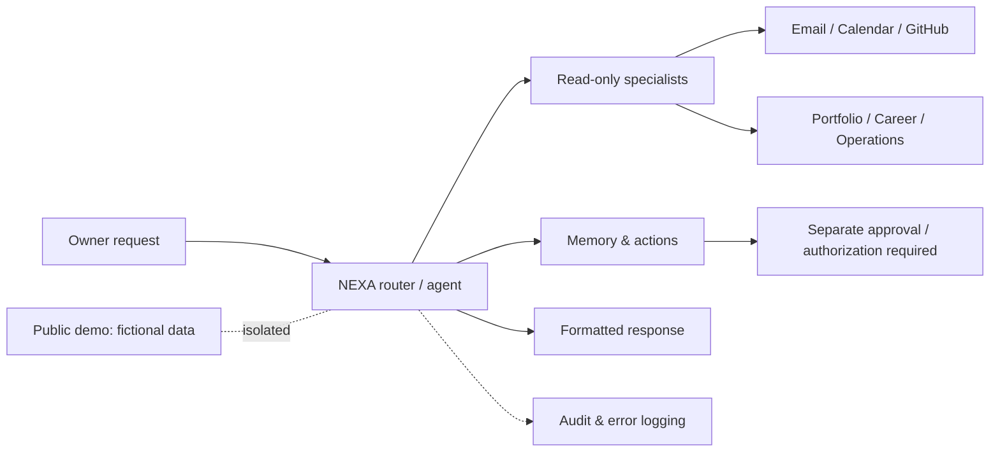

<!-- This document belongs to the dedicated NEXA public engineering case-study repository. The image archive is linked from the original FlyRank submission; the private portfolio source is maintained in a different private repository. -->

<strong>NEXA / WORKFLOW ARCHITECTURE EVIDENCE</strong>

# ✦ NEXA — n8n Workflow Atlas

### Specialist intelligence · routing · operational controls · engineering evidence

  

**Yasmeen Azmat Ali** · October 2026

[**NEXA Overview**](README.md) &nbsp;·&nbsp; [**Workflow Atlas**](NEXA_WORKFLOWS.md) &nbsp;·&nbsp; [**Testing Report**](NEXA_TESTING_REPORT.md) &nbsp;·&nbsp; [**Development Roadmap**](NEXT_CASE_STUDY_PLAN.md) &nbsp;·&nbsp; [**FlyRank Portfolio Evidence**](https://github.com/yasmeenmh90-beep/flyrank-ai-fluency-portfolio-docs/blob/main/FINAL_SUBMISSION_INDEX.md)

---

> **Scope:** This atlas documents the **separate private n8n workflow foundation** using user-provided editor screenshots. It is **not** the source code for the [public NEXA case-study site](https://nexa-public.netlify.app/). The public site deliberately serves fictional, browser-local responses without calling these private workflows.

## 01 · Architecture at a glance

**Diagram status:** Conceptual view of the shown n8n workflows. It does not assert that the unpublished main agent or a protected public-to-private bridge is deployed. The public demo is isolated, not a live client of the router.

## 02 · Implementation-status legend

| Label | Meaning |
|:---|:---|
| **Published** | The n8n editor shows a **Published** status on the screenshot; this alone does not establish tested end-to-end runtime success. |
| **Unpublished** | The editor shows **Publish**, so publication is not evidenced. |
| **Archived** | An intentionally archived test workflow. |
| **Test / placeholder** | Engineering experiment or starter template, not a production feature. |

## 03 · Workflow catalogue

| # | Workflow | Screenshot status | Principal responsibility |
|:--:|:---|:---|:---|
| 01 | [Gmail Specialist](#workflow-01) | Published | Classifies Gmail questions into routes such as inbox summaries, unread mail, important mail, sender searches a |
| 02 | [Operational Intelligence](#workflow-02) | Published | Parses operational questions, reads the NEXA tracker in Google Sheets, distinguishes missing or empty records  |
| 03 | [GitHub Intelligence](#workflow-03) | Published | Resolves a repository target, retrieves repository activity, recent commits, open issues and pull requests, an |
| 04 | [Portfolio Intelligence](#workflow-04) | Published | Collects portfolio repository files and live project links, verifies reachable references, and assembles infor |
| 05 | [Career Intelligence](#workflow-05) | Published | Combines NEXA tracker entries, GitHub repositories, portfolio READMEs and CV text to assemble career evidence  |
| 06 | [Calendar Intelligence](#workflow-06) | Published | Resolves date-related questions, reads personal/FlyRank/UAE-holiday calendars and the NEXA tracker, then produ |
| 07 | [Daily Intelligence](#workflow-07) | Unpublished / Publish shown | Plans a daily summary across calendar events, Gmail, tracker items, GitHub activity, career information and po |
| 08 | [Memory Intelligence](#workflow-08) | Unpublished / Publish shown | Reads stored memories and pending confirmations |
| 09 | [NEXA Main Agent](#workflow-09) | Unpublished / Publish shown | Central assistant receives a request, classifies it, routes it to specialist workflows, handles missing result |
| 10 | [Action Intelligence](#workflow-10) | Unpublished / Publish shown | Coordinates action requests with confirmation checks, calendar context, approval branches, action execution, a |
| 11 | [Proactive Intelligence](#workflow-11) | Unpublished / Publish shown | Checks settings, analyzes recent activity across connected services, considers whether a proactive update is w |
| 12 | [Control Center](#workflow-12) | Unpublished / Publish shown | Validates an incoming dashboard request, gathers operational/health/audit records, renders a dashboard payload |
| 13 | [Error Logger](#workflow-13) | Published | Captures workflow errors, sanitizes/categorizes event data, checks whether the event should be recorded, and w |
| 14 | [Sub-workflow Error Probe](#workflow-14) | Test / Unpublished | Small deliberate-failure sub-workflow used to test error propagation from a called workflow. |
| 15 | [Error Capture Probe](#workflow-15) | Archived test | Archived webhook-triggered probe intended to generate a deliberate failure and inspect error capture. |
| 16 | [Sub-workflow Probe Caller](#workflow-16) | Test / Unpublished | Webhook-driven test caller invokes a failing sub-workflow to exercise error propagation. |
| 17 | [GitHub Tracker Sync](#workflow-17) | Unpublished / Publish shown | Six-hour scheduling design lists repositories, reads the tracker, normalizes and deduplicates, fetches README, |
| 18 | [Starter Sub-workflow](#workflow-18) | Placeholder / Unpublished | Generic 'When Executed by Another Workflow' template with a replace-me node, included as development context. |

## 04 · Individual workflow walkthroughs

> **Screenshot status:** 17 of the 18 catalogue entries have confirmed PNG links under [`assets/n8n/`](https://github.com/yasmeenmh90-beep/flyrank-ai-fluency-portfolio-docs/tree/main/assets/n8n), including the newly verified Probe Caller and Starter Sub-workflow. The Sub-workflow Error Probe still needs its exact repository image filename confirmed. These are editor screenshots, **not execution-level validation**. Review all images for personal or secret information.

### 01 · Gmail Specialist

**Observed status:** Published

**Purpose and flow**

- Classifies Gmail questions into routes such as inbox summaries, unread mail, important mail, sender searches and follow-ups; fetches Gmail messages and prepares an AI-formatted answer.
- **Evidence boundary:** Published workflow definition; individual request success not proven by the diagram.

**Workflow screenshot 01** · [Full-size image](https://github.com/yasmeenmh90-beep/flyrank-ai-fluency-portfolio-docs/blob/main/assets/n8n/GmailSpecialist.png)

### 02 · Operational Intelligence

**Observed status:** Published

**Purpose and flow**

- Parses operational questions, reads the NEXA tracker in Google Sheets, distinguishes missing or empty records from valid records, and prepares an operational analysis.
- **Evidence boundary:** Execution history and data-access tests not supplied.

**Workflow screenshot 02** · [Full-size image](https://github.com/yasmeenmh90-beep/flyrank-ai-fluency-portfolio-docs/blob/main/assets/n8n/OperationalIntelligence.png)

### 03 · GitHub Intelligence

**Observed status:** Published

**Purpose and flow**

- Resolves a repository target, retrieves repository activity, recent commits, open issues and pull requests, and summarizes developer context with fallback branches.
- **Evidence boundary:** Live response accuracy requires execution evidence.

**Workflow screenshot 03** · [Full-size image](https://github.com/yasmeenmh90-beep/flyrank-ai-fluency-portfolio-docs/blob/main/assets/n8n/GithubIntelligence.png)

### 04 · Portfolio Intelligence

**Observed status:** Published

**Purpose and flow**

- Collects portfolio repository files and live project links, verifies reachable references, and assembles information for a portfolio answer.
- **Evidence boundary:** The workflow diagram does not establish that all live links were successfully checked.

**Workflow screenshot 04** · [Full-size image](https://github.com/yasmeenmh90-beep/flyrank-ai-fluency-portfolio-docs/blob/main/assets/n8n/PortfolioIntelligence.png)

### 05 · Career Intelligence

**Observed status:** Published

**Purpose and flow**

- Combines NEXA tracker entries, GitHub repositories, portfolio READMEs and CV text to assemble career evidence and tailored analysis.
- **Evidence boundary:** Career recommendations and source freshness have not been independently validated.

**Workflow screenshot 05** · [Full-size image](https://github.com/yasmeenmh90-beep/flyrank-ai-fluency-portfolio-docs/blob/main/assets/n8n/CareerIntelligence.png)

### 06 · Calendar Intelligence

**Observed status:** Published

**Purpose and flow**

- Resolves date-related questions, reads personal/FlyRank/UAE-holiday calendars and the NEXA tracker, then produces an availability or scheduling summary.
- **Evidence boundary:** Calendar permissions, successful queries and privacy controls need execution-level review.

**Workflow screenshot 06** · [Full-size image](https://github.com/yasmeenmh90-beep/flyrank-ai-fluency-portfolio-docs/blob/main/assets/n8n/CalendarIntelligence.png)

### 07 · Daily Intelligence

**Observed status:** Unpublished / Publish shown

**Purpose and flow**

- Plans a daily summary across calendar events, Gmail, tracker items, GitHub activity, career information and portfolio sources, with missing-source fallbacks.
- **Evidence boundary:** The screenshot shows Publish rather than Published; not a claim of deployment.

**Workflow screenshot 07** · [Full-size image](https://github.com/yasmeenmh90-beep/flyrank-ai-fluency-portfolio-docs/blob/main/assets/n8n/DailyIntelligence.png)

### 08 · Memory Intelligence

**Observed status:** Unpublished / Publish shown

**Purpose and flow**

- Reads stored memories and pending confirmations; interprets requests to read, modify, delete or confirm stored information; includes a credential-refusal path.
- **Evidence boundary:** Sensitive functionality; do not publish memory content, storage IDs or credentials.

**Workflow screenshot 08** · [Full-size image](https://github.com/yasmeenmh90-beep/flyrank-ai-fluency-portfolio-docs/blob/main/assets/n8n/MemoryIntelligence.png)

### 09 · NEXA Main Agent

**Observed status:** Unpublished / Publish shown

**Purpose and flow**

- Central assistant receives a request, classifies it, routes it to specialist workflows, handles missing results and formatting, and records audit metadata.
- **Evidence boundary:** The private assistant is not accessible from the public NEXA sample demo.

**Workflow screenshot 09** · [Full-size image](https://github.com/yasmeenmh90-beep/flyrank-ai-fluency-portfolio-docs/blob/main/assets/n8n/NEXA-Agent.png)

### 10 · Action Intelligence

**Observed status:** Unpublished / Publish shown

**Purpose and flow**

- Coordinates action requests with confirmation checks, calendar context, approval branches, action execution, and an audit trail.
- **Evidence boundary:** Write actions require separate authorization and verified human approval; screenshot does not prove these guarantees.

**Workflow screenshot 10** · [Full-size image](https://github.com/yasmeenmh90-beep/flyrank-ai-fluency-portfolio-docs/blob/main/assets/n8n/ActionIntelligence.png)

### 11 · Proactive Intelligence

**Observed status:** Unpublished / Publish shown

**Purpose and flow**

- Checks settings, analyzes recent activity across connected services, considers whether a proactive update is warranted, and prepares a response.
- **Evidence boundary:** No evidence of live proactive scheduling or delivery in screenshot.

**Workflow screenshot 11** · [Full-size image](https://github.com/yasmeenmh90-beep/flyrank-ai-fluency-portfolio-docs/blob/main/assets/n8n/ProactiveIntelligence.png)

### 12 · Control Center

**Observed status:** Unpublished / Publish shown

**Purpose and flow**

- Validates an incoming dashboard request, gathers operational/health/audit records, renders a dashboard payload and sends the response.
- **Evidence boundary:** Authentication and dashboard access restrictions have not been independently tested.

**Workflow screenshot 12** · [Full-size image](https://github.com/yasmeenmh90-beep/flyrank-ai-fluency-portfolio-docs/blob/main/assets/n8n/ControlCenter.png)

### 13 · Error Logger

**Observed status:** Published

**Purpose and flow**

- Captures workflow errors, sanitizes/categorizes event data, checks whether the event should be recorded, and writes a health event.
- **Evidence boundary:** Shows error-handling design; not proof of every integration failure being caught.

**Workflow screenshot 13** · [Full-size image](https://github.com/yasmeenmh90-beep/flyrank-ai-fluency-portfolio-docs/blob/main/assets/n8n/ErrorLogger.png)

### 14 · Sub-workflow Error Probe

**Observed status:** Test / Unpublished

**Purpose and flow**

- Small deliberate-failure sub-workflow used to test error propagation from a called workflow.
- **Evidence boundary:** A workflow diagram is a test setup, not evidence of a passed test.

**Workflow screenshot 15** · [Full-size image](https://github.com/yasmeenmh90-beep/flyrank-ai-fluency-portfolio-docs/blob/main/assets/n8n/SubWorkflow-ErrorProbe.png)

### 15 · Error Capture Probe

**Observed status:** Archived test

**Purpose and flow**

- Archived webhook-triggered probe intended to generate a deliberate failure and inspect error capture.
- **Evidence boundary:** Archived; do not imply it is currently running.

**Workflow screenshot 15** · [Full-size image](https://github.com/yasmeenmh90-beep/flyrank-ai-fluency-portfolio-docs/blob/main/assets/n8n/ErrorCaptureProbe.png)

### 16 · Sub-workflow Probe Caller

**Observed status:** Test / Unpublished

**Purpose and flow**

- Webhook-driven test caller invokes a failing sub-workflow to exercise error propagation.
- **Evidence boundary:** Requires a recorded test execution to claim pass/fail.

**Workflow screenshot 16** · [Full-size image](https://github.com/yasmeenmh90-beep/flyrank-ai-fluency-portfolio-docs/blob/main/assets/n8n/SubWorkflowProbeCaller.png)

### 17 · GitHub Tracker Sync

**Observed status:** Unpublished / Publish shown

**Purpose and flow**

- Six-hour scheduling design lists repositories, reads the tracker, normalizes and deduplicates, fetches README, classifies a new repository and writes/verifies a tracker entry.
- **Evidence boundary:** Schedule and persistence are design intent until published and observed in runs.

**Workflow screenshot 17** · [Full-size image](https://github.com/yasmeenmh90-beep/flyrank-ai-fluency-portfolio-docs/blob/main/assets/n8n/GithubTrackerSync.png)

### 18 · Starter Sub-workflow

**Observed status:** Placeholder / Unpublished

**Purpose and flow**

- Generic 'When Executed by Another Workflow' template with a replace-me node, included as development context.
- **Evidence boundary:** Not a NEXA production capability; optionally omit from the public gallery.

**Workflow screenshot 18** · [Full-size image](https://github.com/yasmeenmh90-beep/flyrank-ai-fluency-portfolio-docs/blob/main/assets/n8n/StarterSubWorkflow.png)

## 05 · Public-versus-private boundaries

| Public case-study website | Separate n8n workflows |
|:---|:---|
| [nexa-public.netlify.app](https://nexa-public.netlify.app/) | Owner-controlled n8n environment |
| Browser-local sample data | Service-specific workflow definitions |
| Fictional, deterministic demonstration replies | Some workflows integrate with Gmail, Google Calendar, Google Sheets and GitHub |
| No private n8n request path demonstrated | Authenticated backend connection is a future milestone |
| Public for portfolio reviewers | Not intended to be publicly callable |

## 06 · What this evidence supports

- **Architecture visibility:** Screenshots show separately named specialists, routing branches, data-retrieval nodes, fallback paths and monitoring designs.
- **Publication-state visibility:** Several specialist workflows display Published; other workflows display Publish or Archived.
- **Not established from screenshots alone:** Successful executions, credential hygiene, production authorization, approval enforcement, endpoint security, error coverage or a live public-to-private integration.
- **Testing next step:** For each specialist, collect one **sanitized** test execution showing safe input, branch taken, output, status, and date. Never expose tokens, full email bodies, personal events, private webhooks or sensitive logs.

## 07 · Milestones and remaining work

- [x] Build the public NEXA case-study website and fictional interactive demo
- [x] Document the NEXA public-demo testing in [NEXA_TESTING_REPORT.md](NEXA_TESTING_REPORT.md)
- [x] Capture screenshots of 18 n8n workflow definitions, including test and placeholder workflows
- [x] Prepare architecture descriptions, workflow inventory and truthful status labels
- [x] Upload and embed **17 of 18** n8n screenshots with confirmed repository image paths
- [x] Link the **Sub-workflow Probe Caller** and **Starter Sub-workflow** PNGs by their verified filenames
- [ ] Confirm the filename/path and embed the **Sub-workflow Error Probe** screenshot
- [ ] Record sanitized execution-level evidence for each intended integration
- [ ] Design and implement an authenticated, authorized owner-only API boundary
- [ ] Verify action approvals, storage/privacy protections, and operational monitoring
- [ ] Publish/test only workflows selected for private deployment

---

Documentation concerns the provided screenshots and participant reports. It does not grant external access to private systems.
