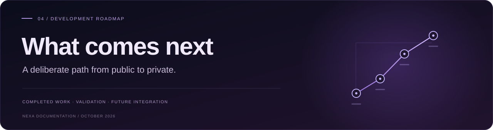

  

# Development roadmap

The public release is available. The next milestones stay explicit.

  

[Overview](README.md) &nbsp; / &nbsp; [Workflow atlas](NEXA_WORKFLOWS.md) &nbsp; / &nbsp; [Testing report](NEXA_TESTING_REPORT.md) &nbsp; / &nbsp; **Roadmap**

RELEASE SNAPSHOT · 15 OCTOBER 2026 · YASMEEN AZMAT ALI

---

> [!NOTE]
> **Current position:** public voice, Live AI, Interview Practice and the guided tour are released. Private authentication and personal-service integration remain separate future work.

<table>
<tr>
<td width="33%"><h3>01 · Available</h3>
Public AI, samples, voice and practice.
</td>
<td width="33%"><h3>02 · Validate</h3>
Devices, accessibility, costs and walkthrough.
</td>
<td width="33%"><h3>03 · Integrate privately</h3>
Review architecture before owner-only access.
</td>
</tr>
</table>

**On this page**  
[At a glance](#at-a-glance) · [Completed work](#completed-work) · [Public priorities](#public-priorities) · [Private integration](#private-integration) · [Portfolio plan](#portfolio-plan) · [Historical context](#historical-context)

---

## 01 · At a glance

| Area | Current position |
| --- | --- |
| Public website | [nexa-public.netlify.app](https://nexa-public.netlify.app/) |
| Runnable public source | [nexa-public](https://github.com/yasmeenmh90-beep/nexa-public) |
| This repository | Documentation, workflow atlas, evidence and roadmap |
| Public AI route | Netlify Function → OpenAI; no private n8n connection |
| Private orchestration | Separate n8n foundation; historical screenshot evidence |
| Private application | `nexa.yasmeenazmat.com` remains a planned owner-only deployment |
| Public project knowledge | No personal-project catalogue added |
| Next public milestone | Current-device/accessibility checks, usage review and clean walkthrough |
| Next private milestone | Read-only architecture/security assessment before integration |

## 02 · Completed public work

| Deliverable | Implemented behavior | Evidence boundary |
| --- | --- | --- |
| Public case study | Refined purple identity, original avatar, compact chat and connected architecture paths | Deployed source and owner-supplied desktop recordings |
| Sample Demo | Six fictional local productivity examples | Earlier visual observations; no private service access |
| General Live AI | Server-side OpenAI request with bounded recent context | Owner-confirmed general answers and follow-ups |
| Voice input/output | Browser recognition, transcript review, spoken replies, Read aloud and Stop speaking | Owner-confirmed behavior in supported browser |
| Interview Practice | AI/ML, full-stack and backend; beginner/intermediate; one-question-at-a-time coaching | Start/question and part of feedback observed; complete progression still needs explicit evidence |
| Guided tour | Six-step local overview with native dialog and navigation controls | Opening/section navigation observed; full keyboard/focus/mobile review pending |
| Visitor tools | Suggestions, copying, Reset and public GitHub issue drafts | Owner-confirmed visitor-tool tests |
| Motion | Entrance/reveal/hover effects, reading progress and reduced-motion handling | Source/lifecycle checks and desktop recordings; not a performance benchmark |
| Source and metadata | Public repository, setup instructions, canonical/social URLs, robots and sitemap | Source/static checks |
| Build and tests | TypeScript, Vite bundle, static render and ten mocked backend tests | Reproducible commands in the application repository |

The public site is no longer a sample-only interface. Conversely, a real public OpenAI endpoint does not mean private n8n integration or owner authentication is complete.

## 03 · Next public work

1. **Finish the current release review.** Verify interview feedback → next question, hints, tour keyboard behavior, microphone permission failures, mode changes and cancellation.
2. **Review mobile and accessibility.** Check current phone/tablet layouts, zoom, touch targets, keyboard order, contrast and assistive-technology behavior. Historical Lighthouse results do not certify this release.
3. **Check operating costs.** Review actual Netlify and OpenAI usage controls. Existing per-IP throttling, context bounds and output caps do not guarantee a global budget.
4. **Record a clean walkthrough.** Show a local sample, a general question, a short interview exchange and browser voice. Exclude account details and unrelated tabs.
5. **Add or verify the main-portfolio entry.** Link the public site, runnable repository and documentation using the existing portfolio publishing process. This documentation update does not claim that entry is already deployed.
6. **Keep releases focused.** Group related source edits into one commit when a deployment is needed. A documentation change here is not a request to rebuild the public site.

> [!NOTE]
> **Avatar scope:** precise facial lip sync is deferred. The unsuccessful deformation experiment was removed; the original portrait retains clearly labelled playback effects.

## 04 · Future private integration

| Phase | Deliverable | Evidence needed |
| --- | --- | --- |
| 14.1 · Architecture/security assessment | Review n8n entry points, sessions, allowed specialists, dependencies and rollback without changing workflows | Reviewed design and documented trust boundaries |
| 14.2 · Owner-only gateway | Authentication, authorization, validated input, server-only credentials and limited audit data | Access-control and negative tests |
| 14.3 · Read-only specialist pilot | Connect one explicitly permitted private specialist first | Sanitized end-to-end execution and failure-path results |
| 14.4 · Private voice/UX | Validate voice and session behavior in the authenticated app | Real-device and privacy checks; public voice success is not private integration evidence |
| 14.5 · Private deployment | Controlled owner-only deployment, monitoring, backup and rollback | Authenticated production smoke tests |
| 14.6 · Portfolio maintenance | Keep public narrative, code links and evidence aligned with actual releases | Checked public entry and dated release notes |

Public chat, the guided tour and interview practice stay outside personal-service access. Persistent memory, write actions and proactive workflows require their own scope, permissions and approval design.

## 05 · Existing n8n foundation

The owner previously reported seven read-only specialist routes verified through n8n’s own chat interface. The [workflow atlas](NEXA_WORKFLOWS.md) documents 18 historical definitions, including error probes and a starter template, with **18 existing screenshot paths now confirmed** in the separate evidence archive.

Those screenshots describe configuration and historical editor publication indicators. They do not independently establish current workflow state, credential validity, safe execution of every branch, or successful website integration.

No n8n workflows, credentials, webhook routes, private memory or service accounts were changed by the public website releases or this documentation update.

## 06 · Portfolio narrative

| Problem | What I did | What came of it |
| --- | --- | --- |
| Fragmented tools and an interface prototype needed a clear, usable public presentation | Built a typed conversational UI, isolated sample/live paths, added browser voice and practice coaching, and documented the private boundary | A deployed public experience with reproducible checks, observed user interactions and explicit limitations |

### Publication checklist

- [x] Publish the dedicated NEXA public website.
- [x] Make runnable public source available in a separate repository.
- [x] Document local samples, Live AI, voice, interview practice and tour.
- [x] Separate historical workflow evidence from public runtime capability.
- [x] Update the testing report without treating older scores as a new audit.
- [ ] Complete current mobile/accessibility and full interview/tour checks.
- [ ] Verify account spending settings and deployed enforcement.
- [ ] Publish a sanitized demonstration video.
- [ ] Add or verify NEXA’s main-portfolio entry and outbound links.
- [ ] Assess the private gateway before connecting personal services.

## 07 · Historical FlyRank reminder and accountability

<strong>Read the dated reminder and FlyRank submission context</strong>

The earlier accepted General AI Fluency submission included a named NEXA portfolio-update reminder for **12 October 2026**. An updated Apple Reminders screenshot supplied on **14 October 2026** showed “NEXA — Complete & Publish Portfolio Case Study,” due **21 October 2026**.

This is historical submission evidence, not a newly created reminder or a guarantee of completion. The earlier screenshot also showed notifications disabled. No reminder or notification setting was inspected or changed in this documentation update.

The dedicated public website is now live. The reminder’s remaining portfolio/publication tasks and future private-system work should be tracked separately, rather than describing the entire public release as a future milestone.

## 08 · Retained working context

Keep the NEXA visual identity, public source, architecture decisions, test commands and original evidence archive as the basis for focused future changes. Earlier local dashboard/login prototypes remain development history; their tests and simulated controls must not be confused with the current public voice/AI release.

**Source snapshot for this update:** [`0ea3dab`](https://github.com/yasmeenmh90-beep/nexa-public/commit/0ea3dab6cf02051e6d8ee9989542b55d0b5792e7).  
**Testing detail:** [NEXA_TESTING_REPORT.md](NEXA_TESTING_REPORT.md).

---

**A clear experience. A documented foundation.**

[Try NEXA ↗](https://nexa-public.netlify.app/) &nbsp; · &nbsp; [Application source ↗](https://github.com/yasmeenmh90-beep/nexa-public) &nbsp; · &nbsp; [Back to top ↑](#top)

NEXA · Public engineering documentation · October 2026

