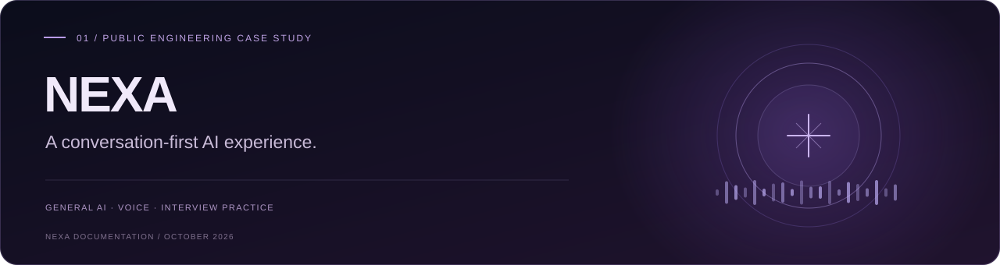
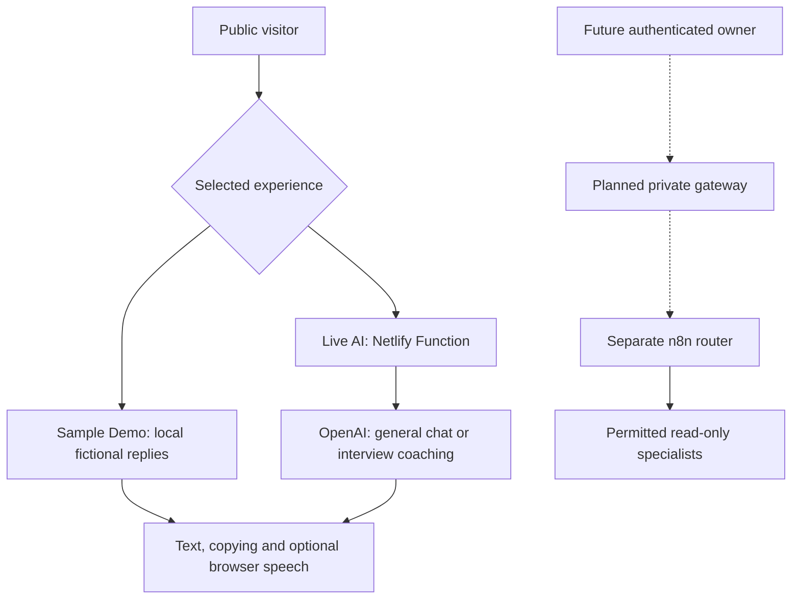

<a id="top"></a>

<p align="center">
  
</p>

<div align="center">

# NEXA · Project overview

A public AI experience, explained through its features, architecture and evidence.

[](https://nexa-public.netlify.app/) [](https://nexa-public.netlify.app/#demo) [](https://nexa-public.netlify.app/#demo) [](NEXA_WORKFLOWS.md)

**Overview** &nbsp; / &nbsp; [Workflow atlas](NEXA_WORKFLOWS.md) &nbsp; / &nbsp; [Testing report](NEXA_TESTING_REPORT.md) &nbsp; / &nbsp; [Roadmap](NEXT_CASE_STUDY_PLAN.md)

<sub>RELEASE SNAPSHOT · 15 OCTOBER 2026 · YASMEEN AZMAT ALI</sub>

</div>

---

> [!NOTE]
> **Start here:** this is the documentation companion. Runnable code lives in [nexa-public](https://github.com/yasmeenmh90-beep/nexa-public); private n8n workflows remain separate.

<table>
<tr>
<td width="50%">
<h3>01 · Explore the experience</h3>
<p>General chat, browser voice, fictional task previews, interview practice and a local guided tour.</p>
<p><a href="https://nexa-public.netlify.app/"><strong>Open the public website ↗</strong></a></p>
</td>
<td width="50%">
<h3>02 · Look behind the interface</h3>
<p>Read the implementation, inspect the public/private boundary and assess the evidence for yourself.</p>
<p><a href="https://github.com/yasmeenmh90-beep/nexa-public"><strong>Explore the runnable source ↗</strong></a></p>
</td>
</tr>
</table>

**On this page**  
[Capabilities](#capabilities) · [Quick start](#quick-start) · [Architecture](#architecture) · [Documentation](#documentation) · [Source & costs](#source-and-costs) · [Evidence & next steps](#evidence)

---

<a id="capabilities"></a>

## 01 · What NEXA does today

NEXA is an interactive public AI experience and an engineering case study. Visitors can try fictional productivity tasks, ask general AI questions, practise technical interviews, and use browser-supported speech input and playback.

| Experience | Available behavior | Boundary |
| --- | --- | --- |
| **Sample Demo** | Daily briefing, Inbox, Calendar, Projects, Career and GitHub examples | Fictional, predefined browser-local content; no OpenAI request |
| **Live AI — General chat** | General questions, explanations and short follow-ups | OpenAI through a Netlify Function; answers may be inaccurate |
| **Interview Practice** | AI/ML, full-stack or backend; beginner/intermediate; one question at a time, hints and constructive feedback | AI-generated educational coaching, not a hiring assessment or validated score |
| **Voice** | Dictate a question, review the transcript, send it, and hear replies | Browser support and available voices vary; recognition may use the browser provider’s service |
| **Guided tour** | Six local steps with Back, Next, Finish and Escape | No AI request; an overview rather than an automated product test |
| **Visitor tools** | Suggested prompts, Copy answer, Reset and GitHub feedback drafts | Feedback is public when submitted; GitHub sign-in is required |
| **Visual experience** | Original hijab-wearing NEXA character, speaking halo/bars, scroll reveals, hover transitions and reading progress | Decorative playback effects; precise lip sync is deferred |

> [!IMPORTANT]
> **Public capability boundary:** no personal-project knowledge catalogue was added. Public NEXA does not read personal email, calendars, private repositories or long-term memory, and does not execute n8n workflows or external actions.

<a id="quick-start"></a>

## 02 · Try it

1. Open [NEXA](https://nexa-public.netlify.app/). Use **Take a guided tour** for an overview.
2. In **Try NEXA**, choose **Sample Demo** for fictional tasks or **Live AI** for general questions.
3. In Live AI, select **Interview Practice**, choose a track and level, then **Start practice**.
4. Type an answer or use **Microphone**, review the text, and press **Send**.
5. Enable **Spoken replies**, or use **Read aloud** for an existing answer.
6. Use **Copy answer**, **Stop speaking**, or **Reset chat** as needed.

Live AI sends up to three recent completed exchanges for context, within a 6000-character history limit. This app clears its browser-held context on Reset, mode changes or refresh; changing interview track or level starts a new practice session. This is not persistent personal memory.

<a id="architecture"></a>

## 03 · Architecture and trust boundary



There is no connection from the public paths to the private n8n route. The OpenAI key is handled server-side. Owner authentication and authorization for personal services remain future work.

<a id="documentation"></a>

## 04 · Documentation

| Document | Contents |
| --- | --- |
| [Workflow atlas](NEXA_WORKFLOWS.md) | 18 historical workflow definitions, screenshot links and publication-evidence limits |
| [Testing report](NEXA_TESTING_REPORT.md) | Current source/build checks, ten mocked backend tests, user-observed behavior, historical Lighthouse results and remaining checks |
| [Development roadmap](NEXT_CASE_STUDY_PLAN.md) | Completed public features, private-integration milestones and portfolio publication tasks |
| [FlyRank evidence archive](https://github.com/yasmeenmh90-beep/flyrank-ai-fluency-portfolio-docs) | Earlier submission material and original workflow screenshots |

The existing gallery images describe an earlier dashboard prototype; they are not screenshots of every current feature. Original n8n images stay in the [existing screenshot archive](https://github.com/yasmeenmh90-beep/flyrank-ai-fluency-portfolio-docs/tree/main/assets/n8n).

<a id="source-and-costs"></a>

## 05 · Source, setup and costs

This repository contains documentation only. To run the public application:

```bash
git clone https://github.com/yasmeenmh90-beep/nexa-public.git
cd nexa-public
npm ci
npm run dev
```

**Runtime:** Node.js 22. Vite alone serves the frontend and local samples; Live AI needs the Netlify Function environment. Follow the [application README](https://github.com/yasmeenmh90-beep/nexa-public#readme) for build, deployment and the server-only environment variable names.

The implemented function validates requests, bounds history, applies a 20-second upstream timeout and requests at most 400 output tokens. Its Netlify rate-limit configuration is five requests per 60 seconds per IP/domain grouping. These controls are not a global spending cap or proof of account-budget configuration. Netlify usage and OpenAI API usage are separate.

<a id="evidence"></a>

## 06 · Evidence and remaining work

TypeScript compilation, a Vite production build, static rendered-HTML checks and **10 mocked backend tests** passed for the latest application update. Owner-provided recordings show tour navigation and the first interview question; a later screenshot shows feedback after an answer and the speech-playback state. Earlier voice, general chat, copying and follow-up tests were owner-confirmed.

The next-question transition after feedback, all tour keyboard/focus cases, real-phone behavior and a complete accessibility review still need explicit evidence. Historical Lighthouse scores belong to an earlier release, not a new audit of the current site.

Private authentication, personal-service connections, long-term memory, action execution and precise lip sync remain future work. See the [testing report](NEXA_TESTING_REPORT.md) for the exact evidence boundaries.

**Application source reviewed:** [`0ea3dab`](https://github.com/yasmeenmh90-beep/nexa-public/commit/0ea3dab6cf02051e6d8ee9989542b55d0b5792e7).  
**Author:** Yasmeen Azmat Ali · 2026.

---

<div align="center">

**A clear experience. A documented foundation.**

[Try NEXA ↗](https://nexa-public.netlify.app/) &nbsp; · &nbsp; [Application source ↗](https://github.com/yasmeenmh90-beep/nexa-public) &nbsp; · &nbsp; [Back to top ↑](#top)

<sub>NEXA · Public engineering documentation · October 2026</sub>

</div>
