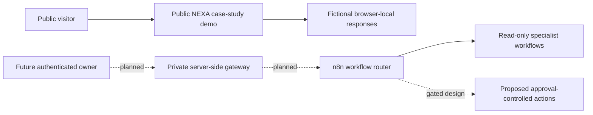

# ✦ NEXA
### Personal AI Operations Assistant · Public Engineering Case Study

**Agent routing · Workflow orchestration · Secure integration design · Applied AI**

[Live public showcase](https://nexa-public.netlify.app/) · [Main AI/ML portfolio](https://yasmeenazmat.com/) · [FlyRank submission evidence](https://github.com/yasmeenmh90-beep/flyrank-ai-fluency-portfolio-docs)

---

## Overview

**NEXA** is a personal AI operations assistant engineering project. This repository provides a **public case study** of its user experience, designed n8n specialist workflows, testing observations, and remaining engineering milestones.

The [public showcase](https://nexa-public.netlify.app/) uses **fictional, predefined responses**; it is not connected to a private mailbox, authenticated NEXA agent, or live personal-data integrations. Separately, n8n workflow editor screenshots show the internal routing and service-integration designs. A published workflow indicator is not proof of end-to-end runtime success.

## Documentation status

**Public engineering case study — available.** The browser-based demo uses fictional local responses, while private authenticated workflows are a separate development layer. The dedicated Markdown files below are now maintained in this repository. The original PNG assets are retained in the [FlyRank evidence screenshot archive](https://github.com/yasmeenmh90-beep/flyrank-ai-fluency-portfolio-docs/tree/main/assets/n8n) and referenced from the workflow atlas, rather than duplicating sensitive architecture images or merging them into the private portfolio source.

## Explore the case study

| Document | What you'll find |
|---|---|
| [Workflow architecture and screenshots](NEXA_WORKFLOWS.md) | The main agent, Gmail, GitHub, calendar, memory, operational intelligence, actions, monitoring and test probes |
| [Public showcase testing](NEXA_TESTING_REPORT.md) | Sample UI checks, responsive captures, Lighthouse results and their limitations |
| [Implementation roadmap](NEXT_CASE_STUDY_PLAN.md) | What's built, what is planned, technical decisions and the next portfolio milestone |
| [Original FlyRank documentation](https://github.com/yasmeenmh90-beep/flyrank-ai-fluency-portfolio-docs) | Official submission index, portfolio report and retrospective |

## Architecture and trust boundary

**The dashed links describe planned integration, not a currently deployed public-to-private connection.** Credentials, owner-only services, raw workflow exports and personal records are not part of this public repository.

## Engineering evidence

Screenshots of the n8n editor are stored in the [existing FlyRank documentation repository](https://github.com/yasmeenmh90-beep/flyrank-ai-fluency-portfolio-docs/tree/main/assets/n8n) and are referenced in the [workflow atlas](NEXA_WORKFLOWS.md). They demonstrate workflow structure, but cannot establish that every route passed real execution tests.

The public sample UI was visually exercised across ten observed cases. A supplied Lighthouse screenshot reported **100 Performance**, **96 Accessibility**, **100 Best Practices** and **100 SEO** for a particular audit run. These are not permanent guarantees or evidence of production authentication/security certification. See the [testing report](NEXA_TESTING_REPORT.md) for details.

## What is next?

The remaining work includes a read-only architecture/security assessment, authenticated gateway, integration-level tests, approved private specialist connections, honest voice/avatar capability labeling, and future addition as a complete case study on the [main portfolio](https://yasmeenazmat.com/).

## Source and usage

This repository contains **documentation**, not the runnable private NEXA assistant or private n8n workflow exports. Visitors can try the isolated [public example](https://nexa-public.netlify.app/). There is **no installation procedure for the private system in this repository**.

**Author:** Yasmeen Azmat Ali · 2026
