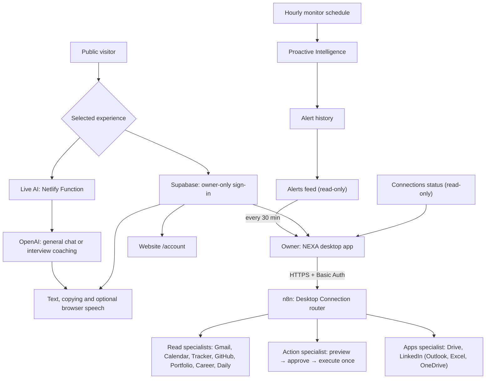

<a id="top"></a>

<p align="center">
  
</p>

<div align="center">

# NEXA · Project overview

A public AI experience, explained through its features, architecture and evidence.

[](https://nexa-public.netlify.app/) [](https://nexa-public.netlify.app/#demo) [](https://nexa-public.netlify.app/#demo) [](#private-assistant)

**Overview** &nbsp; / &nbsp; [Workflow atlas](NEXA_WORKFLOWS.md) &nbsp; / &nbsp; [Testing report](NEXA_TESTING_REPORT.md) &nbsp; / &nbsp; [Roadmap](NEXT_CASE_STUDY_PLAN.md)

<sub>RELEASE SNAPSHOT · 29 OCTOBER 2026 · YASMEEN AZMAT ALI</sub>

</div>

---

> [!NOTE]
> **Start here:** this is the documentation companion. NEXA has two parts: a **public website** (runnable code in [nexa-public](https://github.com/yasmeenmh90-beep/nexa-public)) and a **private desktop assistant** connected to owner-only n8n workflows. The private app and workflows are not public; this page documents what they do and how they were tested.

<table>
<tr>
<td width="50%">
<h3>01 · Explore the experience</h3>
<p>General chat, browser voice, fictional task previews, interview practice and a local guided tour.</p>
<p><a href="https://nexa-public.netlify.app/"><strong>Open the public website ↗</strong></a></p>
</td>
<td width="50%">
<h3>02 · Look behind the interface</h3>
<p>Read the implementation, inspect the public/private boundary and assess the evidence for yourself.</p>
<p><a href="https://github.com/yasmeenmh90-beep/nexa-public"><strong>Explore the runnable source ↗</strong></a></p>
</td>
</tr>
</table>

**On this page**  
[Capabilities](#capabilities) · [Private assistant](#private-assistant) · [Quick start](#quick-start) · [Architecture](#architecture) · [Documentation](#documentation) · [Source & costs](#source-and-costs) · [Evidence & next steps](#evidence)

---

<a id="capabilities"></a>

## 01 · What the public website does

NEXA is an interactive public AI experience and an engineering case study. Visitors can try fictional productivity tasks, ask general AI questions, practise technical interviews, and use browser-supported speech input and playback.

| Experience | Available behavior | Boundary |
| --- | --- | --- |
| **Sample Demo** | Daily briefing, Inbox, Calendar, Projects, Career and GitHub examples | Fictional, predefined browser-local content; no OpenAI request |
| **Live AI — General chat** | General questions, explanations and short follow-ups | OpenAI through a Netlify Function; answers may be inaccurate |
| **Interview Practice** | AI/ML, full-stack or backend; beginner/intermediate; one question at a time, hints and constructive feedback | AI-generated educational coaching, not a hiring assessment or validated score |
| **Voice** | Dictate a question, review the transcript, send it, and hear replies | Browser support and available voices vary; recognition may use the browser provider’s service |
| **Guided tour** | Six local steps with Back, Next, Finish and Escape | No AI request; an overview rather than an automated product test |
| **Owner sign-in and policies** | `/signin`, `/account`, `/privacy`, `/terms`, `/security`; **Open NEXA desktop** link | Supabase accounts limited to the owner by a database trigger; public sign-up is off |
| **Visitor tools** | Suggested prompts, Copy answer, Reset and GitHub feedback drafts | Feedback is public when submitted; GitHub sign-in is required |
| **Visual experience** | Original hijab-wearing NEXA character, speaking halo/bars, scroll reveals, hover transitions and reading progress | Decorative playback effects; precise lip sync is deferred |

> [!IMPORTANT]
> **Public capability boundary:** no personal-project knowledge catalogue was added. The public website does not read personal email, calendars, private repositories or long-term memory, and does not execute n8n workflows or external actions. Its sign-in is limited to the owner and only opens the private desktop assistant below, where those capabilities live.

<a id="private-assistant"></a>

## 02 · The private assistant (owner only)

A macOS desktop app (Electron, React, TypeScript) that talks to the owner's n8n Cloud workflows. Built and tested between 17 and 28 October 2026.

| Capability | How it works | Status |
| --- | --- | --- |
| **Local AI** | Qwen3 8B through Ollama on the Mac; no cloud model, no personal-service access | Working (owner-tested) |
| **Local voice** | Dictation with whisper.cpp on the Mac; replies read aloud with macOS speech | Working (owner-tested) |
| **Private workflows** | Free-form questions go to an authenticated n8n webhook; an intent router sends them to Gmail, Calendar, Tracker, GitHub, Portfolio, Career or Daily specialists | Working (owner-tested 25 Oct) |
| **Approval-gated actions** | Send an email; create, move or delete a personal calendar event; save to Drive; publish a LinkedIn post | Working (owner-tested 25–28 Oct) |
| **Proactive alerts** | Hourly monitors (calendar reminders, deadlines, important email) feed HIGH/CRITICAL alerts to macOS notifications | Working (owner-observed) |
| **Owner sign-in** | Same Supabase account as the website; session encrypted in the macOS Keychain; the website's **Open NEXA desktop** button opens the installed app | Working (owner-tested 28 Oct) |
| **Connected apps** | Panel showing which apps are connected (Gmail, Calendar, Sheets, Drive, GitHub, LinkedIn, Outlook, Excel, OneDrive); **Connect** opens n8n credentials | Working: 6 of 9 connected |
| **Google Drive and LinkedIn** | Read Drive files and Google Docs, read the LinkedIn profile; save a note to Drive or publish a LinkedIn post **after approval** | Working (owner-tested 27–28 Oct) |
| **Outlook, Excel, OneDrive** | Same approval pattern (send email, add a row, save a file) | Built; not connected (no Microsoft account) |
| **Memory changes, proactive requests from chat** | Exist in n8n but are deliberately routed to a "disabled" reply | Disabled |

### How write actions stay safe

1. The request never executes directly. The Action specialist answers with a **preview** (recipient, subject and body, or event title and time) and stores it as *pending* for **15 minutes**.
2. The desktop app shows **Approve / Cancel** under the preview. Approve sends only the exact phrase the workflow asked for (for example *"Yes, send it"*); the app never sends a different instruction.
3. n8n **claims** the pending action with a token, re-reads it, waits 3 seconds and checks the token again before running, so one confirmation runs at most once. Repeated "Yes" replies get "already processed".
4. The outcome is checked against Gmail or Google Calendar's response and written to an action log. Failures are never retried automatically.

### Security boundaries

- The app connects only to an HTTPS n8n Cloud production URL with Basic Auth; redirects are refused.
- The URL and credentials are encrypted on the Mac with Keychain-backed storage; they are not in the code or the bundle.
- The interface runs sandboxed with no Node access; it cannot choose a URL or read the saved credentials.
- Action and monitor workflows do not save execution data, and send errors to a sanitizing error logger.

<a id="quick-start"></a>

## 03 · Try the public website

1. Open [NEXA](https://nexa-public.netlify.app/). Use **Take a guided tour** for an overview.
2. In **Try NEXA**, choose **Sample Demo** for fictional tasks or **Live AI** for general questions.
3. In Live AI, select **Interview Practice**, choose a track and level, then **Start practice**.
4. Type an answer or use **Microphone**, review the text, and press **Send**.
5. Enable **Spoken replies**, or use **Read aloud** for an existing answer.
6. Use **Copy answer**, **Stop speaking**, or **Reset chat** as needed.

Live AI sends up to three recent completed exchanges for context, within a 6000-character history limit. This app clears its browser-held context on Reset, mode changes or refresh; changing interview track or level starts a new practice session. This is not persistent personal memory.

<a id="architecture"></a>

## 04 · Architecture and trust boundary



The public website has **no** path to the private n8n workflows. The private side is reachable only from the owner's desktop app with the owner's credentials. The OpenAI key for the public site stays server-side.

<a id="documentation"></a>

## 05 · Documentation

| Document | Contents |
| --- | --- |
| [Workflow atlas](NEXA_WORKFLOWS.md) | 18 workflow definitions with screenshots, plus the three workflows added for the desktop app |
| [Testing report](NEXA_TESTING_REPORT.md) | Public site checks and the private desktop release: 26 automated tests and 10 owner-run end-to-end tests |
| [Development roadmap](NEXT_CASE_STUDY_PLAN.md) | Completed public features, private-integration milestones and portfolio publication tasks |
| [FlyRank evidence archive](https://github.com/yasmeenmh90-beep/flyrank-ai-fluency-portfolio-docs) | Earlier submission material and original workflow screenshots |

The existing gallery images describe an earlier dashboard prototype; they are not screenshots of every current feature. Original n8n images stay in the [existing screenshot archive](https://github.com/yasmeenmh90-beep/flyrank-ai-fluency-portfolio-docs/tree/main/assets/n8n).

<a id="source-and-costs"></a>

## 06 · Source, setup and costs

This repository contains documentation only. The private desktop app is not published. To run the public application:

```bash
git clone https://github.com/yasmeenmh90-beep/nexa-public.git
cd nexa-public
npm ci
npm run dev
```

**Runtime:** Node.js 22. Vite alone serves the frontend and local samples; Live AI needs the Netlify Function environment. Follow the [application README](https://github.com/yasmeenmh90-beep/nexa-public#readme) for build, deployment and the server-only environment variable names.

The implemented function validates requests, bounds history, applies a 20-second upstream timeout and requests at most 400 output tokens. Its Netlify rate-limit configuration is five requests per 60 seconds per IP/domain grouping. These controls are not a global spending cap or proof of account-budget configuration. Netlify usage and OpenAI API usage are separate.

<a id="evidence"></a>

## 07 · Evidence and remaining work

TypeScript compilation, a Vite production build, static rendered-HTML checks and **10 mocked backend tests** passed for the latest application update. Owner-provided recordings show tour navigation and the first interview question; a later screenshot shows feedback after an answer and the speech-playback state. Earlier voice, general chat, copying and follow-up tests were owner-confirmed.

The next-question transition after feedback, all tour keyboard/focus cases, real-phone behavior and a complete accessibility review still need explicit evidence. Historical Lighthouse scores belong to an earlier release, not a new audit of the current site.

**Sign-in and connected apps (26–28 October 2026):** 33 desktop tests and the 10 website tests passed; the owner tested website and desktop sign-in, the connected-apps panel, Drive read and approved save, LinkedIn profile, a cancelled LinkedIn draft, the website-to-desktop link and a proactive notification.

**Private desktop release (25 October 2026):** 26 automated tests, a TypeScript check and a production build passed. The owner ran 10 end-to-end tests through the desktop app: seven read-only specialist questions, a free-form availability question, a confirmed email send and a confirmed calendar create-and-delete — all returned results confirmed by Gmail or Google Calendar.

Still open: the 15-minute expiry in daily use, the Microsoft agents (no account connected), memory changes from chat (disabled), and precise lip sync. See the [testing report](NEXA_TESTING_REPORT.md) for the exact evidence boundaries.

**Application source reviewed:** [`0ea3dab`](https://github.com/yasmeenmh90-beep/nexa-public/commit/0ea3dab6cf02051e6d8ee9989542b55d0b5792e7).  
**Author:** Yasmeen Azmat Ali · 2026.

---

<div align="center">

**A clear experience. A documented foundation.**

[Try NEXA ↗](https://nexa-public.netlify.app/) &nbsp; · &nbsp; [Application source ↗](https://github.com/yasmeenmh90-beep/nexa-public) &nbsp; · &nbsp; [Back to top ↑](#top)

<sub>NEXA · Public engineering documentation · October 2026</sub>

</div>
